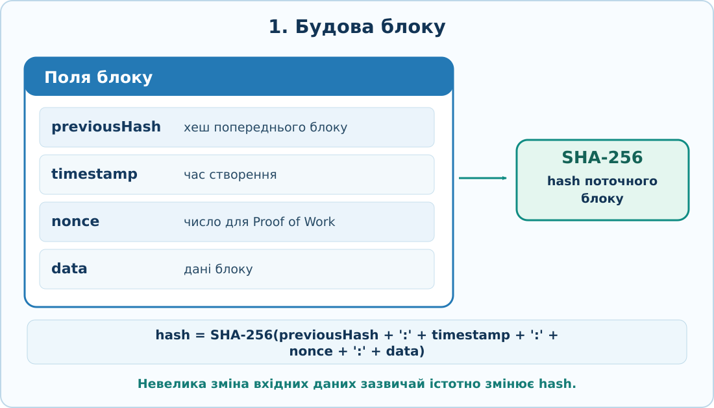
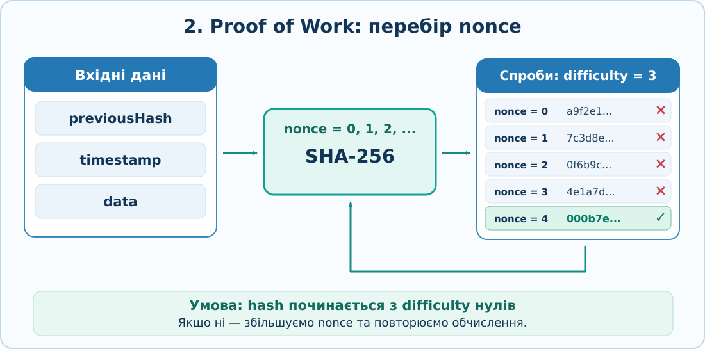
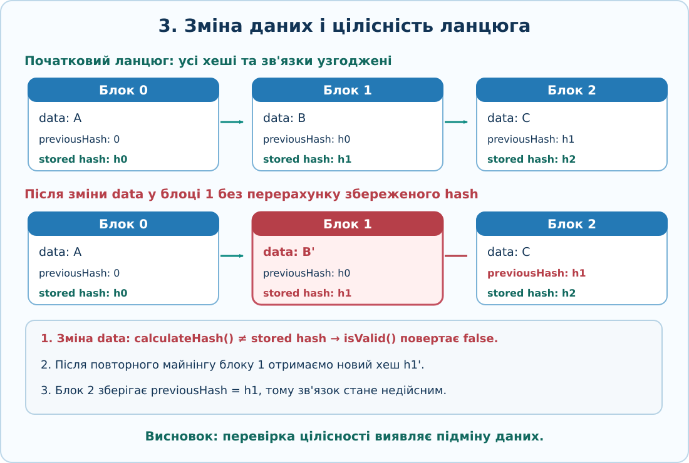

<!-- SPDX-License-Identifier: CC-BY-NC-SA-4.0 -->
# Лабораторна робота №5. Дослідження принципів технології Blockchain

**Дисципліна:** [Розподілені системи](../../README.md)  
**Мова програмування:** [Java](https://en.wikipedia.org/wiki/Java_(programming_language)) 17 (або новіша)  
**Форма роботи:** демонстрація викладача → експерименти → самостійне дослідження [open-source](https://en.wikipedia.org/wiki/Open-source_software) проєкту.

## Мета роботи

На прикладі мінімальної реалізації [блокчейну](https://en.wikipedia.org/wiki/Blockchain) дослідити, як пов'язані між собою [хешування](https://en.wikipedia.org/wiki/Cryptographic_hash_function), структура блоку, [Proof of Work (PoW)](https://en.wikipedia.org/wiki/Proof_of_work) і перевірка цілісності ланцюга. Навчитися знаходити відповідні алгоритми в незнайомому відкритому Java-проєкті та критично оцінювати його реалізацію.

**Мета не полягає у створенні [криптовалюти](https://en.wikipedia.org/wiki/Cryptocurrency) чи написанні блокчейну з нуля.** Основний результат — обґрунтовані спостереження та висновки, отримані під час експериментів і читання коду.

## Передумови та інструменти

- Базове знання Java: класи, поля, цикли, колекції, виклики методів.
- [JDK](https://en.wikipedia.org/wiki/Java_Development_Kit) 17+ і [Maven](https://en.wikipedia.org/wiki/Apache_Maven) 3.9+ (або [IDE](https://en.wikipedia.org/wiki/Integrated_development_environment) з підтримкою Maven: IntelliJ IDEA, Eclipse, VS Code).
- [Git](https://en.wikipedia.org/wiki/Git) і доступ до GitHub для самостійного дослідження NoobChain.

Навчальний приклад оформлено як **Maven-проєкт** зі стандартною структурою `src/main/java`. Його вихідний код використовує лише стандартну бібліотеку Java, **без Gson та інших сторонніх бібліотек**. Перший запуск Maven може потребувати доступу до інтернету для отримання плагінів.

## Короткі теоретичні відомості

Блок має повідомлення `data`, час створення `timestamp`, посилання `previousHash` на хеш попереднього блоку, число [`nonce`](https://en.wikipedia.org/wiki/Nonce_(cryptography)) і власний `hash`.

У цьому прикладі:

```text
hash = SHA-256(previousHash + ":" + timestamp + ":" + nonce + ":" + data)
```



*Рис. 1. Поля блоку та обчислення його хешу в навчальному Java-прикладі.*

[SHA-256](https://en.wikipedia.org/wiki/SHA-2) повертає 256-бітний результат, який програма показує як 64 [шістнадцяткові](https://en.wikipedia.org/wiki/Hexadecimal) символи. Навіть невелика зміна вхідних даних зазвичай істотно змінює хеш.

Щоб виконати **Proof of Work**, програма перебирає `nonce`, доки шістнадцятковий запис хешу не починатиметься з `difficulty` нулів. Кожний початковий нуль у шістнадцятковому записі відповідає чотирьом нульовим бітам. Для незалежних рівномірних хешів математичне очікування кількості спроб становить приблизно `16^difficulty`; фактична кількість сильно варіюється.



*Рис. 2. Пошук nonce за заданою складністю; наведені значення хешів умовні.*

Ланцюг перевіряється за трьома умовами для **кожного** блоку (включно з початковим):

1. `previousHash` відповідає збереженому хешу попереднього блоку (для [genesis block](https://en.wikipedia.org/wiki/Genesis_block) — рядок `"0"`).
2. Збережений `hash` дорівнює повторно обчисленому хешу даних блоку.
3. `hash` задовольняє умову складності PoW.



*Рис. 3. Зміна даних руйнує відповідність збереженого та обчисленого хешу; повторний майнінг додатково порушує посилання наступного блоку.*

Це **навчальна локальна модель**, а не реалізація Bitcoin. Тут немає [транзакцій](https://en.wikipedia.org/wiki/Bitcoin#Transactions), [цифрових підписів](https://en.wikipedia.org/wiki/Digital_signature), вузлів [мережі](https://en.wikipedia.org/wiki/Distributed_computing), [консенсусу](https://en.wikipedia.org/wiki/Consensus_(computer_science)), правила вибору ланцюга чи захисту від того, що хтось повторно побудує весь ланцюг. Перевірка локальної цілісності не доводить автентичності історії в розподіленій мережі. Формат рядка для хешування також спрощений і не є стандартом серіалізації Bitcoin.

## Початковий код

Три класи в каталозі [`src/main/java/ua/cn/stu/blockchain/`](src/main/java/ua/cn/stu/blockchain/):

| Клас | Призначення |
| --- | --- |
| [`Block.java`](src/main/java/ua/cn/stu/blockchain/Block.java) | Дані блоку, SHA-256, перебір `nonce` |
| [`Blockchain.java`](src/main/java/ua/cn/stu/blockchain/Blockchain.java) | Створення genesis, додавання блоків, перевірка ланцюга |
| [`Main.java`](src/main/java/ua/cn/stu/blockchain/Main.java) | Експерименти та виведення результатів |

**Відкриття в IDE.** Відкрийте [файл `pom.xml`](pom.xml) або каталог `lab-05-blockchain` як **Maven-проєкт**. IDE автоматично визначить `src/main/java` як каталог вихідних файлів. Виберіть JDK 17+ та запустіть метод `main()` класу `ua.cn.stu.blockchain.Main`; аргумент програми `3` можна задати в конфігурації запуску.

**Збирання та запуск у терміналі** з каталогу `lab-05-blockchain`:

```bash
mvn compile
mvn exec:java -Dexec.args="3"
```

Обидві команди можна виконати за один виклик:

```bash
mvn compile exec:java -Dexec.args="3"
```

Плагін запуску вже налаштований у `pom.xml`, тому ім'я головного класу в команді вказувати не потрібно. Команда `mvn package` додатково збирає JAR у `target/`.

Число `3` — значення `difficulty`. Можна вказати `1`–`5` (обмеження введене, щоб випадково не запускати надто довгий перебір на навчальному комп'ютері). Без аргументу використовується `3`.

Програма створює три блоки (genesis і два повідомлення), показує їхні `nonce`, час майнінгу та хеші, після чого друкує:

```text
Valid chain: true
After data change: false
After re-mining block 1: false
```

Хеші, `nonce` та час виконання **не є фіксованими**: вони можуть відрізнятися між запусками. Час для genesis включає початкову ініціалізацію програми, тож для порівняння продуктивності орієнтуйтеся переважно на наступні блоки та декілька повторів.

## Демонстрація викладача

1. Відкрити `Block`, простежити, з яких полів формується рядок для SHA-256.
2. Поставити точку зупину в `Block.mine()`; подивитися, як змінюються `nonce` та `hash`.
3. У `Blockchain.isValid()` знайти всі три умови перевірки.
4. Запустити `Main`: спочатку ланцюг коректний, потім зміна даних руйнує його цілісність.
5. Виконати повторний PoW для зміненого блоку: чому перевірка всього ланцюга все ще повертає `false`?

## Завдання для самостійних експериментів

**Експеримент 1. Складність PoW.** Запустіть програму зі значеннями `difficulty = 1, 2, 3, 4`. Для кожного значення повторіть запуск хоча б тричі. Записуйте `nonce` та час для **блоку 1** (не genesis). Обчисліть приблизні середні значення. Чи зростає вартість пошуку зі складністю? Чому виміри не збігаються точно з `16^difficulty`? Значення `5` — необов'язковий додатковий експеримент.

| difficulty | Очікувані спроби `16^d` | Середній `nonce` (блок 1) | Середній час, мс |
| --- | ---: | ---: | ---: |
| 1 | 16 |  |  |
| 2 | 256 |  |  |
| 3 | 4096 |  |  |
| 4 | 65536 |  |  |

*У нашій початковій реалізації при першому майнінгу блоку кількість обчислень хешу дорівнює `nonce + 1`.* Час залежить від обладнання та роботи [JVM](https://en.wikipedia.org/wiki/Java_virtual_machine), тому не варто робити висновки на основі одного запуску.

**Експеримент 2. Зміна даних.** У налагоджувачі простежте, які саме умови в `Blockchain.isValid()` стають хибними після виклику `changeDataForDemo()`. Поясніть, чому не потрібно змінювати хеш вручну, щоб виявити підміну.

**Експеримент 3. Повторний майнінг.** Простежте стан блоку 1 після повторного виклику `mine()`. Чому наявність коректного PoW для зміненого блоку ще не означає коректності всього ланцюга? Які інші блоки довелось би перерахувати?

**Експеримент 4. Початковий блок.** Змініть у `Main` індекс у виклику `changeDataForDemo()` з `1` на `0` і повторіть запуск. Як перевірка виявляє зміну genesis? Уявіть, що його не перевіряли б.

## Самостійне дослідження відкритого проєкту NoobChain

Оригінальний проєкт: **[CryptoKass/NoobChain-Tutorial-Part-1](https://github.com/CryptoKass/NoobChain-Tutorial-Part-1)** (ліцензія MIT).

```bash
git clone https://github.com/CryptoKass/NoobChain-Tutorial-Part-1.git
```

Знайдіть у його коді такі відповідники:

| Наш приклад | NoobChain |
| --- | --- |
| `Block.calculateHash()` | `Block.calculateHash()` та `StringUtil.applySha256()` |
| `Block.mine()` | `Block.mineBlock()` |
| `Blockchain.add()` | `NoobChain.addBlock()` |
| `Blockchain.isValid()` | `NoobChain.isChainValid()` |
| `Main.main()` | `NoobChain.main()` |

Ознайомтеся з класами [`Block.java`](https://github.com/CryptoKass/NoobChain-Tutorial-Part-1/blob/master/src/noobchain/Block.java), [`StringUtil.java`](https://github.com/CryptoKass/NoobChain-Tutorial-Part-1/blob/master/src/noobchain/StringUtil.java), [`NoobChain.java`](https://github.com/CryptoKass/NoobChain-Tutorial-Part-1/blob/master/src/noobchain/NoobChain.java). Оригінал орієнтований на Java 8 і використовує Gson для виведення JSON; **для виконання дослідницького завдання достатньо читати код, збирати NoobChain не обов'язково**.

Дайте обґрунтовані відповіді, посилаючись на відповідні методи:

1. Де виконується SHA-256 і як формується її вхідний рядок?
2. Що означає `difficulty` у двох проєктах? Чим схожий пошук `nonce`?
3. Які перевірки виконує `isChainValid()`? З якого індексу починається цикл? Чи перевіряється genesis?
4. Які наслідки матиме зміна вже збережених даних або хешу блоку?
5. Яких компонентів бракує обом програмам для реальної розподіленої криптовалюти?

**Не потрібно копіювати чи переробляти весь NoobChain.** Мета — зрозуміти й порівняти його код із уже дослідженою мінімальною реалізацією.

## Звіт та контрольні запитання

Подайте короткий звіт, який містить:

- Таблицю результатів експерименту зі складністю (зазначте `difficulty`, `nonce`, час та кількість запусків).
- Пояснення експериментів із порушенням цілісності та повторним майнінгом.
- Порівняння відповідних класів і методів із NoobChain та висновок щодо перевірки genesis.
- Відповіді на дослідницькі запитання своїми словами.

Для самоперевірки: чим відрізняються хешування та [шифрування](https://en.wikipedia.org/wiki/Encryption)? Навіщо блоку `previousHash`? Чому PoW дорогий для створення, але відносно дешевий для перевірки? Чи гарантує коректний локальний ланцюг, що всі вузли мережі мають однакову історію? Чому наведена модель ще не є Bitcoin?

## Ліцензії

Авторські методичні матеріали: **CC BY-NC-SA 4.0**. Авторський Java-код: **GPL-3.0-or-later**. Зовнішній проєкт NoobChain не копіюється в репозиторій; його код розповсюджується авторами на умовах **MIT**. Див. [політику ліцензування](../../../LICENSES.md).


## Додаткові матеріали для самостійного вивчення

Наведені матеріали доповнюють нашу мінімалістичну модель і допоможуть зрозуміти її зв'язок із реальними блокчейн-системами.

**Українською мовою**

1. [WhiteBIT Blog — «Що таке nonce у криптографії?»](https://blog.whitebit.com/uk/ethereum-nonce-explained/) — роль nonce в пошуку відповідного хешу, а також відмінності між nonce під час майнінгу та лічильником транзакцій в Ethereum. Зіставте з `Block.mine()`.
2. [Ethereum.org — «Доказ виконання роботи (PoW)»](https://ethereum.org/uk/developers/docs/consensus-mechanisms/pow/) — доступний опис PoW, перевірки виконаної роботи та узгодження стану між вузлами. **Увага:** це опис історичного механізму Ethereum; у вересні 2022 року мережа перейшла на Proof of Stake.

**Англійською мовою**

3. [Learn Me A Bitcoin — «Mining»](https://learnmeabitcoin.com/technical/mining/) — технічне й наочне пояснення пошуку коректного хешу блока Bitcoin. Порівняйте його з циклом пошуку `nonce` в Java-прикладі.
4. [Bitcoin Developer Guide — «Block Chain»](https://developer.bitcoin.org/devguide/block_chain.html) — структура ланцюга Bitcoin, заголовок блока, genesis block, складність і розгалуження ланцюга. Прочитайте, чому локальна перевірка блоків не замінює мережевого консенсусу.

У тексті методичних вказівок додатково наведені прямі посилання на **англомовну Wikipedia** для основних технічних термінів.

© 2026 Oleksiy Lukin.
