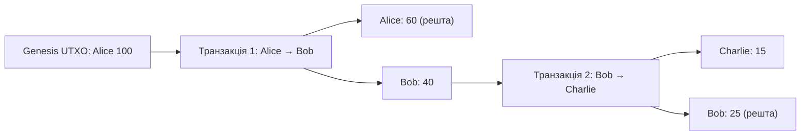
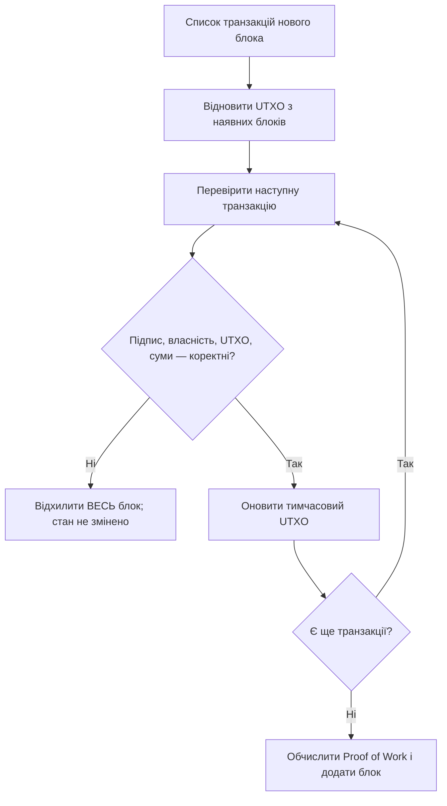

<!-- SPDX-License-Identifier: CC-BY-NC-SA-4.0 -->
# Лабораторна робота №6. Транзакції, цифрові підписи та блоки в Blockchain

**Дисципліна:** [Розподілені системи](../../README.md)  
**Інструменти:** Java 17+, Maven 3.9+, Java IDE  
**Метод роботи:** демонстрація викладача → дослідження мінімального коду → експерименти → аналіз open-source проєкту.

## Мета роботи

Дослідити, як [транзакції](https://en.wikipedia.org/wiki/Bitcoin#Transactions), [цифрові підписи](https://en.wikipedia.org/wiki/Digital_signature) й модель невитрачених виходів (UTXO) доповнюють [блокчейн](https://en.wikipedia.org/wiki/Blockchain), вивчений у [лабораторній №5](../lab-05-blockchain/README.md). Зрозуміти, як кілька транзакцій упаковуються в один блок, чому важливий порядок їх виконання і як перевірка блоків відновлює поточний стан системи.

Результат роботи — **пояснення спостережень та самостійний аналіз коду**, а не написання криптовалюти з нуля. Студенти працюють із готовою компактною навчальною реалізацією.

## Необхідні інструменти

- JDK 17 або новіший, Maven 3.9+ та IDE з підтримкою Maven (IntelliJ IDEA, Eclipse або VS Code).
- Базові знання Java, колекцій і обробки винятків.
- Git та доступ до GitHub для дослідження стороннього проєкту.

Основний приклад використовує **тільки стандартні засоби Java**. Зовнішня залежність JUnit 5 потрібна лише для автоматичних тестів. Maven може завантажити плагіни та тестові залежності під час першого збирання.

## Теоретичні відомості

### Гаманці, ключі та цифровий підпис

У нашій моделі [гаманець](https://en.wikipedia.org/wiki/Cryptocurrency_wallet) — це пара [приватного й публічного ключів](https://en.wikipedia.org/wiki/Public-key_cryptography). Приватний ключ підписує транзакцію, а публічний дозволяє перевірити підпис.

Java-приклад використовує [ECDSA](https://en.wikipedia.org/wiki/Elliptic_Curve_Digital_Signature_Algorithm) через стандартний Java Security API (`SHA256withECDSA`, крива `secp256r1`). Це навчальний вибір: він **не відтворює** всі криптографічні алгоритми й правила підпису Bitcoin, де використовуються також `secp256k1` та підписи Schnorr.

**Підписуються всі істотні поля транзакції:** перелік витрачуваних UTXO, власник-автор підпису, публічні ключі отримувачів, суми виходів і версія навчального формату. Дані кодуються однозначно — з явним зазначенням довжин полів. Зміна будь-якого підписаного поля робить підпис некоректним.

### Модель UTXO та решта (change)

[UTXO](https://en.wikipedia.org/wiki/Unspent_transaction_output) (*Unspent Transaction Output*) — ще не витрачений вихід попередньої транзакції. Замість редагування чисел у «рахунках» кожна звичайна транзакція **витрачає наявні UTXO** та **створює нові**. Ідентифікатор виходу в нашому прикладі має вигляд `transactionId:index`.

Наприклад, якщо Alice володіє UTXO номіналом **100** одиниць і хоче передати Bob **40**, транзакція витрачає початковий UTXO та створює два виходи:

- `40` — новий UTXO для Bob;
- `60` — новий UTXO для Alice, тобто [решта](https://en.wikipedia.org/wiki/Bitcoin#Transactions) (*change*).

Після цього Bob може витратити свій вихід на 40: передати Charlie 15 і повернути собі 25 решти. У навчальному прикладі **немає комісій**, тому сума входів звичайної транзакції **точно дорівнює** сумі її виходів.



*Рис. 1. Один початковий UTXO витрачається повністю, а транзакції створюють нові виходи. Обидві транзакції можна включити до одного блока в наведеному порядку.*

### Перевірка транзакцій та атомарність блоку

Система перевіряє такі **інваріанти**:

1. Цифровий підпис коректний, і кожний вхід посилається на існуючий невитрачений UTXO.
2. Вхід належить власнику публічного ключа, яким підписано транзакцію; один UTXO не повторюється серед входів транзакції.
3. Суми додатні, цілочисельні (`long`), а сума входів дорівнює сумі виходів. Арифметичне переповнення неприпустиме.
4. У вже прийнятій історії не може повторно з'явитися ідентична транзакція; витрачений UTXO більше недоступний.

Транзакції всередині блока перевіряються **послідовно**: вихід попередньої транзакції вже доступний наступній. Тому їхній порядок має значення.

Перед додаванням блока система перевіряє **всі** його транзакції на тимчасовому стані. Якщо хоча б одна некоректна, блок відхиляється повністю: жодний UTXO з нього не переходить у підтверджений стан. Це спрощена демонстрація [атомарності](https://en.wikipedia.org/wiki/Atomicity_(database_systems)).



*Рис. 2. Перевірка кандидата в блок без часткової зміни підтвердженого стану.*

### Блоки та відновлення стану

На відміну від лабораторної №5, `Block` містить **упорядкований список транзакцій**. У хеш блока входять його заголовок та ідентифікатори транзакцій, які, своєю чергою, залежать від їхнього вмісту та підписів. Залишилися посилання `previousHash`, `nonce` й [Proof of Work](https://en.wikipedia.org/wiki/Proof_of_work).

У початковому блоці ([genesis block](https://en.wikipedia.org/wiki/Genesis_block)) є спеціальна транзакція, яка одноразово створює 100 навчальних монет для Alice. Її ідентифікатор і хеш genesis слугують локальною точкою довіри. Винагороди майнерам у цій роботі немає.

Метод `Blockchain.replay()` послідовно перевіряє всі блоки та застосовує їхні транзакції, **заново обчислюючи UTXO Set**. Баланс гаманця — це сума невитрачених виходів, що йому належать. Розподіленої мережі, [консенсусу](https://en.wikipedia.org/wiki/Consensus_(computer_science)), [мемпулу](https://en.wikipedia.org/wiki/Bitcoin#Transactions), [дерева Меркла](https://en.wikipedia.org/wiki/Merkle_tree), складних скриптів та комісій поки немає: вони виходять за межі цієї лабораторної.

## Організація Java-проєкту

Відкрийте [Maven-проєкт `pom.xml`](pom.xml) в IDE. У каталозі [`src/main/java/ua/cn/stu/blockchain/`](src/main/java/ua/cn/stu/blockchain/) є шість невеликих класів:

| Клас | Призначення |
| --- | --- |
| [`Wallet`](src/main/java/ua/cn/stu/blockchain/Wallet.java) | Генерація ключів, створення та перевірка цифрового підпису |
| [`Transaction`](src/main/java/ua/cn/stu/blockchain/Transaction.java) | Входи, виходи, підпис, ідентифікатор і спеціальна genesis-транзакція |
| [`Ledger`](src/main/java/ua/cn/stu/blockchain/Ledger.java) | Набір UTXO, контроль прав власності, перевірка сум, обчислення балансів |
| [`Block`](src/main/java/ua/cn/stu/blockchain/Block.java) | Список транзакцій, `previousHash`, `nonce`, майнінг |
| [`Blockchain`](src/main/java/ua/cn/stu/blockchain/Blockchain.java) | Перевірка й додавання блока, повторне відтворення стану |
| [`Main`](src/main/java/ua/cn/stu/blockchain/Main.java) | Демонстрація транзакцій та некоректних сценаріїв |

Пакети й Maven `groupId` використовують домен університету: `ua.cn.stu`.

**У терміналі** з каталогу лабораторної роботи:

```bash
mvn clean test
mvn exec:java -Dexec.args="2"
```

Можна також виконати `mvn compile exec:java -Dexec.args="2"`. Число `2` — складність PoW (допустимі значення `1`–`4`, значення за замовчуванням — `2`). Автоматичні [JUnit 5](https://junit.org/junit5/)-тести лежать у [`src/test/java`](src/test/java/ua/cn/stu/blockchain/BlockchainTest.java).

В IDE достатньо відкрити Maven-проєкт, вибрати JDK 17+ і запустити `ua.cn.stu.blockchain.Main` або `BlockchainTest`.

Очікувана послідовність результатів (формулювання помилок може дещо відрізнятися):

```text
Wrong order rejected: Missing or spent UTXO
Balances after block 1: Alice=60, Bob=25, Charlie=15
Chain valid: true
Double spending rejected: Missing or spent UTXO
Overspending rejected: Inputs and outputs must balance (no fees)
Signature valid after changing outputs: false
Altered signature payload rejected: Invalid transaction or signature
Chain valid after block tampering: false
Chain valid after restoring block: true
```

## Демонстрація викладача

1. Створити три гаманці й простежити виклики `Wallet.sign()` та `Wallet.verify()`.
2. Розглянути `Transaction.signed()` і метод серіалізації: які поля захищає підпис?
3. На прикладі `Main` показати, як UTXO на 100 одиниць породжує виходи 40 та 60.
4. У налагоджувачі пройти два виклики `Ledger.apply()` під час додавання блока з двома залежними транзакціями.
5. Показати, що `Blockchain.replay()` відновлює баланси з історії, а некоректний кандидат у блок не змінює її.

## Самостійні експерименти

**Експеримент 1. Дві транзакції в одному блоці.** Дослідіть `aToB` та `bToC` у `Main`. Поставте точки зупину в `Ledger.apply()`. Заповніть таблицю для кожного кроку:

| Стан | Alice | Bob | Charlie | Сума |
| --- | ---: | ---: | ---: | ---: |
| Genesis | 100 | 0 | 0 | 100 |
| Після Alice → Bob |  |  |  |  |
| Після Bob → Charlie |  |  |  |  |

Змініть порядок цих транзакцій у `addBlock()`. Поясніть причину відмови.

**Експеримент 2. Double-spending та атомарність.** Дослідіть `spendOnce` та `spendTwice`: обидві транзакції витрачають один і той самий UTXO. Чому відхиляється увесь кандидат у блок? Перевірте кількість блоків і баланс Alice до та після спроби.

**Експеримент 3. Суми та підписи.** Спробуйте витратити 26 одиниць із виходу номіналом 25, змінити суму вже підписаної транзакції та підписати витрачання чужого UTXO своїм ключем. Яку саме перевірку порушено в кожному випадку? Чому коректний цифровий підпис **сам по собі** ще не дозволяє витрачати чужі виходи?

**Експеримент 4. Перевірка блока та replay.** Відкрийте `Block.replaceTransactionForDemo()` і подивіться, як зміна транзакції після майнінгу впливає на `Blockchain.isValid()`. Поверніть оригінальну транзакцію. Повторно викличте `replay()` й переконайтеся, що відновлені баланси збігаються з очікуваними. Чому перевірка стану неможлива без правильного порядку транзакцій?

> **Не використовуйте реальні криптовалютні ключі чи кошти.** Код призначений виключно для навчальних експериментів.

## Самостійне дослідження NoobChain Part 2

Відкрийте [CryptoKass/NoobChain-Tutorial-Part-2](https://github.com/CryptoKass/NoobChain-Tutorial-Part-2). Це продовження проєкту з попередньої лабораторної, тепер із транзакціями й гаманцями. У ньому є класи `Wallet`, `Transaction`, `TransactionInput`, `TransactionOutput`, `Block` і `NoobChain`. Оригінал орієнтований на Java 8 і використовує Gson та Bouncy Castle. Для цього завдання **достатньо читати код**, збирати його не обов'язково.

Знайдіть відповідники наших класів та методів:

- `Transaction.signed()` ↔ `Transaction.generateSignature()`, `verifySignature()`;
- `Ledger.apply()` ↔ `Transaction.processTransaction()`;
- `Ledger.Utxo` ↔ `TransactionOutput`;
- `Blockchain.replay()` ↔ `NoobChain.isChainValid()`;
- `Wallet.publicKey()` ↔ `Wallet.publicKey` і логіка `Wallet.sendFunds()`.

**Завдання для code review** (без переписування всього проєкту):

1. Який тип використано для грошових сум? Чи придатний він для точного фінансового обліку?
2. Які поля охоплює цифровий підпис у NoobChain? Чи підписує він конкретні входи UTXO?
3. Як перевіряється рівність сум входів і виходів? Що станеться, якщо сума виходів завелика?
4. Коли саме змінюється глобальний UTXO Set? Чи можливий частково застосований некоректний блок?
5. Як перевіряється право витрачати UTXO? Чим відрізняється порівняння об'єктів ключів через `==` від порівняння їхнього криптографічного представлення?
6. Яких механізмів не вистачає для роботи кількох незалежних вузлів? Що логічно винести до наступної лабораторної?

**Ліцензування стороннього проєкту:** на момент підготовки роботи в корені Part 2 не було окремого файла LICENSE. Тому його вихідні файли **не копіюються** до цього репозиторію, а використовуються лише через зовнішні посилання для ознайомлення.

## Звіт і контрольні запитання

Короткий звіт має містити таблицю балансів, результати чотирьох експериментів, пояснення перевірок транзакції, приклади відхилених сценаріїв і відповіді на запитання щодо NoobChain із посиланнями на конкретні методи.

Для самоперевірки: навіщо потрібна решта? Чим вихід відрізняється від балансу гаманця? Що забезпечує цифровий підпис, а що — UTXO Set? Чому порядок транзакцій у блоці важливий? Що таке double-spending? Чому невдалий блок не повинен змінювати підтверджений стан? Чим перевірка локального ланцюга відрізняється від консенсусу між вузлами?

## Ліцензування

Авторські методичні матеріали — **CC BY-NC-SA 4.0**; наш Java-код — **GPL-3.0-or-later**. Див. [правила ліцензування репозиторію](../../../LICENSES.md).

## Додаткові матеріали для самостійного вивчення

**Українською**

1. [Bitcoin.org — «Словник»](https://bitcoin.org/uk/vocabulary) — короткі визначення транзакцій, блоків, ключів та інших базових понять Bitcoin.
2. [Bitcoin.com — «Що таке UTXO в біткойні?»](https://www.bitcoin.com/uk/get-started/bitcoin/technical/what-are-bitcoin-utxos/) — пояснення виходів, решти й зв'язку між транзакціями.

**Англійською**

3. [Bitcoin Developer Guide — «Transactions»](https://developer.bitcoin.org/devguide/transactions.html) — технічна структура входів і виходів транзакцій, підписи, комісії та перевірка.
4. [Learn Me A Bitcoin — «UTXO»](https://learnmeabitcoin.com/technical/transaction/utxo/) — наочне пояснення невитрачених виходів та їхнього подальшого використання.

© 2026 Oleksiy Lukin.
