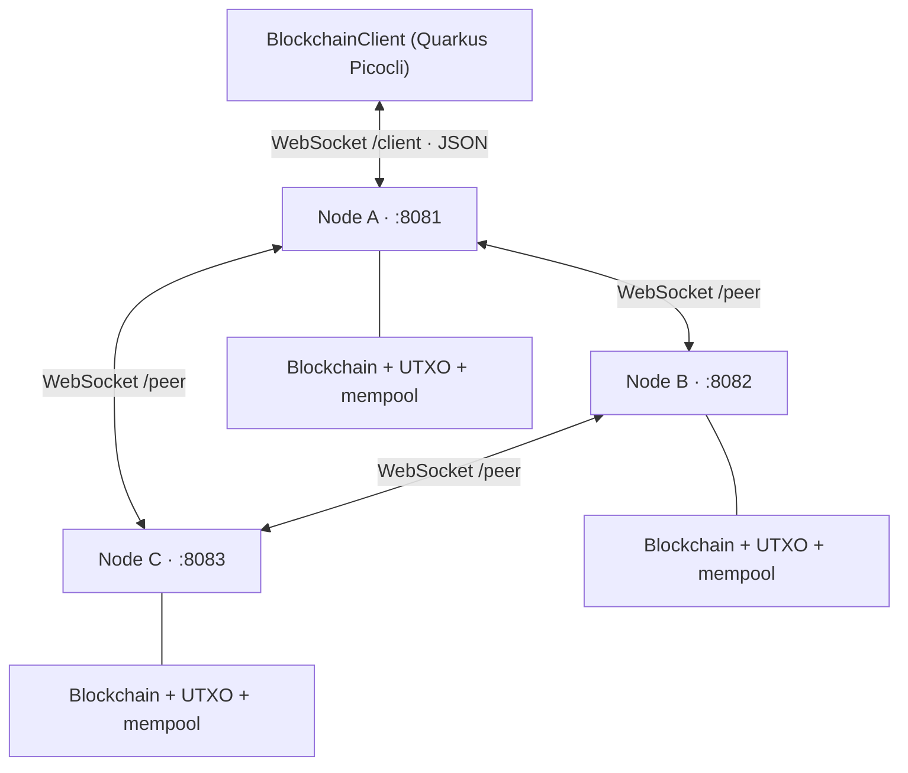
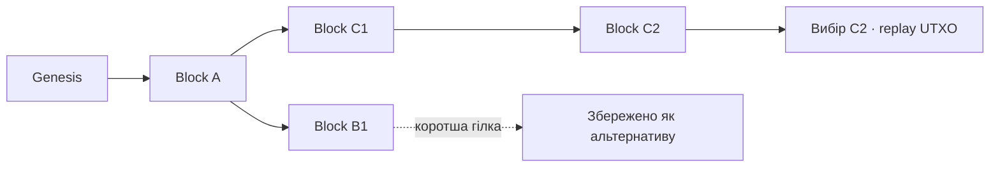

<!-- SPDX-License-Identifier: CC-BY-NC-SA-4.0 -->
# Лабораторна робота №7. Розподілений Blockchain: P2P-мережа та консенсус

**Курс:** [«Розподілені системи»](../../README.md)  
**База:** [лабораторна №6 — транзакції, цифрові підписи та блоки](../lab-06-blockchain-transactions/README.md)  
**Технології:** Java **25 LTS**, Maven, Quarkus **3.40.1.2**, WebSockets Next, Jackson JSON, Picocli.  
**Метод:** демонстрація викладача → дослідження коду → чотири експерименти → вивчення реального open-source проєкту.

## Мета роботи

Дослідити, як три незалежні процеси обмінюються підписаними транзакціями та блоками, обирають гілку блокчейну за накопиченою роботою, реагують на [мережеві розділення](https://en.wikipedia.org/wiki/Network_partition) та відновлюють однаковий стан UTXO за допомогою повторного виконання історії. Студент повинен **спостерігати і пояснювати** роботу алгоритмів, а не реалізувати криптовалюту з нуля.

Робота не відтворює повний Bitcoin: це **навчальна модель Nakamoto-style consensus**, без реальних коштів, економіки майнінгу, гнучкої складності, mempool policy, повноцінних скриптів чи захисту від ворожого P2P-вузла.

## Архітектура



*Рис. 1. Три окремі процеси з незалежним станом і спільним протоколом. Для всіх вузлів використовується один `genesis.json`.*

| Модуль | Призначення |
| --- | --- |
| [`blockchain-core/`](blockchain-core/) | Java-алгоритми: Wallet, Transaction, Ledger, Block, Chain із підтримкою альтернативних гілок; Quarkus не потрібний |
| [`blockchain-protocol/`](blockchain-protocol/) | DTO (`record`), Jackson, JSON ↔ Java, перевірка закріпленого Genesis |
| [`blockchain-node/`](blockchain-node/) | Quarkus WebSockets Next `/peer` і `/client`, mempool, поширення блоків і транзакцій, синхронізація |
| [`blockchain-client/`](blockchain-client/) | Quarkus command mode + Picocli, локальні гаманці, відправлення підписаних транзакцій |

У [№6](../lab-06-blockchain-transactions/README.md) блокчейн містив один лінійний ланцюг. Тепер `Chain` зберігає **дерево блоків**, перевіряє кожну гілку від Genesis та обирає одну основну історію. Після перемикання відновлюється набір UTXO, а непідтверджені транзакції повторно перевіряються на новому стані.

### Спільний Genesis

[`blockchain-core/src/main/resources/genesis.json`](blockchain-core/src/main/resources/genesis.json) містить повний блок із фіксованими `timestamp`, `nonce`, `hash` та першою транзакцією (100 умовних одиниць для Alice). Кожен процес завантажує однаковий ресурс із classpath. Хеш закріплений окремо у `JsonCodec.GENESIS_HASH`. **Десеріалізація не створює новий блок і не майнить його повторно.** Вузли з різними Genesis не можуть синхронізувати історію.

Тестовий ключ початкового власника міститься в [`blockchain-client/src/main/resources/demo-alice-wallet.json`](blockchain-client/src/main/resources/demo-alice-wallet.json). Це **відкритий, усім відомий приватний ключ виключно для лабораторної** — його не можна використовувати для реальних коштів. Ключі нових гаманців зберігаються у локальному каталозі `wallets/`, який додано до `.gitignore`. У навчальній програмі ключі зберігаються без шифрування; захищене сховище ключів виходить за межі завдання.

### WebSocket і JSON

Обидва endpoint підтримуються Quarkus WebSockets Next, на одному порту:

- `ws://localhost:8081/peer` — повідомлення між вузлами;
- `ws://localhost:8081/client` — запити консольного клієнта.

Для наступних вузлів відповідно порти 8082 і 8083. Кожний WebSocket-пакет — **текстове JSON-повідомлення** з полями `type`, `requestId`, `sender`, `genesis` і `payload`. Наприклад:

```json
{
  "type": "GET_CHAIN",
  "requestId": "example-42",
  "sender": "A",
  "genesis": "<спільний хеш Genesis>",
  "payload": {}
}
```

Типи P2P-повідомлень: `HELLO`, `HELLO_ACK`, `NEW_TX`, `NEW_BLOCK`, `GET_CHAIN`, `CHAIN`, `ERROR`. `GET_CHAIN` передає запит на поточну обрану гілку, а `CHAIN` — впорядкований список її блоків, включно з Genesis. Це навмисно простий протокол для **трьох локальних вузлів**, а не оптимізований протокол Bitcoin.

Команди `/client`: `STATUS`, `UTXOS`, `SUBMIT_TX`, `TX_STATUS`, `MINE`, `PEERS`, `DISCONNECT`, `RECONNECT`.

**Важливо:** JSON — тільки транспортне представлення. Поля публічних ключів X.509 і підписів передаються Base64; `txId`, підписи та хеш блока обчислюються за **однозначним бінарним форматом**, успадкованим із лабораторної №6. Зміна порядку полів JSON не змінює криптографічну ідентичність. Отримані дані перевіряються повторно.

### Вибір гілки та відновлення стану



*Рис. 2. Гілки можуть бути обидві криптографічно коректними, але вузол обирає одну історію.*

Складність PoW у нашій моделі **фіксована: два шістнадцяткові нулі**. Тому накопичена робота прямо пропорційна кількості перевірених блоків. При однаковій роботі для відтворюваності використовується лексикографічно менший хеш вершини гілки (навчальне правило, **не правило Bitcoin**). Підтвердження транзакції не остаточне: після reorganization її статус може змінитися.

Ланцюг імпортується атомарно: якщо хоч один блок/транзакція не проходить перевірку, відхиляється **вся нова гілка**. `Ledger` кожного вузла повністю виводиться зі своєї поточної історії. Для порівняння станів виводиться відтворюваний `utxoFingerprint`.

Вузол веде локальний **mempool** (набір прийнятих, але ще не включених до обраного ланцюга транзакцій). Кожна транзакція спершу перевіряється відносно UTXO з урахуванням уже прийнятих транзакцій mempool. Повторні повідомлення не створюють дублікати. При реорганізації вміст mempool проходить повторну перевірку.

## Підготовка і запуск

Потрібні JDK 25, Maven 3.9+, доступ до Maven Central під час першого складання. Ресурси комп'ютера: достатньо трьох звичайних Java-процесів, контейнерів та зовнішньої БД немає.

З каталогу **цієї лабораторної**:

```bash
mvn clean verify
mvn -DskipTests package
```

Відкрийте **три термінали** в корені `lab-07-distributed-blockchain`. Запустіть вузли (кожний рядок в окремому терміналі):

```bash
NODE_NAME=A NODE_PORT=8081 NODE_PEERS='B@ws://localhost:8082,C@ws://localhost:8083' \
  java -jar blockchain-node/target/quarkus-app/quarkus-run.jar

NODE_NAME=B NODE_PORT=8082 NODE_PEERS='A@ws://localhost:8081,C@ws://localhost:8083' \
  java -jar blockchain-node/target/quarkus-app/quarkus-run.jar

NODE_NAME=C NODE_PORT=8083 NODE_PEERS='A@ws://localhost:8081,B@ws://localhost:8082' \
  java -jar blockchain-node/target/quarkus-app/quarkus-run.jar
```

Завдяки авто-підключенню кожні три секунди вузли можуть запускатися в довільному порядку. У четвертому терміналі виконуйте команди клієнта:

```bash
# Навчальна пара ключів початкового власника Genesis (тільки один раз)
java -jar blockchain-client/target/quarkus-app/quarkus-run.jar wallet-demo
# Створити ще два гаманці (тільки один раз)
java -jar blockchain-client/target/quarkus-app/quarkus-run.jar wallet-create --name bob
java -jar blockchain-client/target/quarkus-app/quarkus-run.jar wallet-create --name charlie

# Отримати стан A, баланс Alice, переслати 40 одиниць Bob
java -jar blockchain-client/target/quarkus-app/quarkus-run.jar --node ws://localhost:8081/client status
java -jar blockchain-client/target/quarkus-app/quarkus-run.jar --node ws://localhost:8081/client balance --wallet alice
java -jar blockchain-client/target/quarkus-app/quarkus-run.jar --node ws://localhost:8081/client send --from alice --to bob --amount 40
java -jar blockchain-client/target/quarkus-app/quarkus-run.jar --node ws://localhost:8082/client mine
java -jar blockchain-client/target/quarkus-app/quarkus-run.jar --node ws://localhost:8083/client balance --wallet bob
```

Через коротку затримку поширення перед останньою командою переконайтеся, що всі вузли мають однаковий `tip` (команда `status`). `send` відправляє **підписану** транзакцію без приватного ключа. Після `send` баланс на підтвердженому UTXO ще не змінився; після `mine` на одному вузлі й синхронізації зміниться на всіх.

**Quarkus Dev UI:** щоб запустити вузол A у режимі розробки, після збірки виконайте `NODE_NAME=A NODE_PORT=8081 NODE_PEERS='B@ws://localhost:8082,C@ws://localhost:8083' mvn -f blockchain-node/pom.xml quarkus:dev`. Інші два вузли можна залишити звичайними JVM-процесами. Сторінка Dev UI: `http://localhost:8081/q/dev-ui`. WebSocket-повідомлення додатково видно в DEBUG-логах Quarkus. Dev UI доступний тільки в **dev mode**.

## Демонстрація викладача

1. Показати `genesis.json`, `JsonCodec.createChain()`, `Chain` і самостійні `Ledger` трьох вузлів. Порівняти `genesis` та `utxoFingerprint`.
2. Поставити breakpoint у `ClientEndpoint.receive()`, `NodeService.submit()`, `PeerEndpoint.receive()` та `OutboundPeer.received()`. Надіслати транзакцію з клієнта, простежити **WebSocket → Jackson JSON → Transaction → Ledger**.
3. Замайнити блок на B, простежити `Chain.accept()`, відправлення `NEW_BLOCK`, оновлення статусу C.
4. Показати мережеве розділення та конкурентний майнінг. Після відновлення зв'язку перейти в `Chain.importPath()` і `Ledger.fingerprint()`.

## Самостійні експерименти

### Експеримент 1. Поширення транзакції

Створіть Bob і Charlie. Через `/client` вузла A надішліть 40 одиниць Alice → Bob, перевірте `mempool` у `status` трьох вузлів і замайніть блок на B. Поясніть, чому до майнінгу `balance` не змінюється. Знайдіть у debugger, де перевіряються підпис та право витратити UTXO.

### Експеримент 2. Синхронізація вузла, що відстав

Виконайте `disconnect` між C та обома іншими вузлами **в обох напрямках**. Наприклад, команда для A з `--node ws://localhost:8081/client disconnect --peer C` і аналогічна для B, C. Замайніть два блоки на A, потім `reconnect` усі чотири напрямки. Порівняйте `height`, `tip`, `utxoFingerprint` **до та після** синхронізації. У реалізації `disconnect` — це *логічне мережеве розділення*: повідомлення фільтруються без примусового закриття WebSocket-з'єднання.

### Експеримент 3. Fork і зміна обраної історії

Повторіть розділення мережі: вузли A/B залишаються разом, а C ізольований. На A створіть **два** нові блоки, а на C — **один**. Зверніть увагу, що `mine` дозволяє створювати порожні блоки спеціально для демонстрації PoW та fork. Відновіть зв'язок. Переконайтеся, що після синхронізації усі вузли обрали гілку A. Перевірте, чи зберігається альтернативний блок C в `knownBlocks`, і чи однаковий `utxoFingerprint`. Поясніть різницю між валідним блоком і блоком обраного ланцюга.

### Експеримент 4. Недовірені повідомлення та ідентичність мережі

У debugger змініть поле `hash` в отриманому JSON-блоці або `amount` у підписаній транзакції. Перевірте, які саме перевірки відхиляють зміну. Окремо змініть `genesis.json` у **локальному експериментальному проєкті** та перевірте, чому `JsonCodec.GENESIS_HASH` не дозволяє запустити несумісну мережу. Не змінюйте оригінальні навчальні ресурси в Git.

## Таблиця результатів

| Експеримент | Вузол | Height до / після | Tip до / після | UTXO fingerprint | Пояснення |
| --- | --- | --- | --- | --- | --- |
| 1 | A / B / C | | | | |
| 2 | A / B / C | | | | |
| 3 | A / B / C | | | | |
| 4 | A / B / C | | | | |

## Самостійне дослідження реального проєкту

Перегляньте [bitcoinj](https://github.com/bitcoinj/bitcoinj) — бібліотеку реалізації Bitcoin-протоколу на Java. Знайдіть відповідні компоненти для мережевих peers, обміну блоками, зберігання/вибору ланцюга. Поясніть, чому наша навчальна система надсилає **повний список блоків** у повідомленні `CHAIN`, а промислове ПЗ оптимізує синхронізацію. Не потрібно компілювати bitcoinj чи переносити сторонній код до навчального проєкту.

Додаткове порівняння: у [Bitcoin Developer Guide — P2P Network](https://developer.bitcoin.org/devguide/p2p_network.html) знайдіть механізми поширення транзакцій і початкової синхронізації. Порівняйте їх із нашими `NEW_TX`, `NEW_BLOCK`, `GET_CHAIN`.

## Звіт і контрольні запитання

Подайте результати чотирьох експериментів, таблицю станів, короткий висновок та посилання на досліджені класи й методи. Відповідайте власними словами: чому всім потрібний однаковий Genesis? Чому хешування **JSON-тексту** не підходить як ідентичність транзакції? Чому одержаний блок перевіряють, а не майнять знову? Чим локальна коректність блока відрізняється від вибору історії мережею? Як після reorganization змінюються UTXO та статус транзакції? Що станеться, якщо не перевіряти `sender` і хеш Genesis у повідомленнях?

## Межі навчальної моделі

Система працює лише в локальній довіреній лабораторній мережі: `ws://` без TLS, без криптографічної автентифікації peers, peer discovery, rate limiting, журналу на диску, транзакційних комісій і persistence mempool. Ідентифікатор `sender` у JSON не автентифікується. Вузли автоматично повторюють спроби підключення, але WebSocket-з'єднання можуть обірватися; механізми обмеження пам'яті та обробки ворожого трафіку неповні. Накопичена робота спрощена: фіксована складність PoW. **Це не безпечна платіжна система й не реалізація Bitcoin.**

## Додаткові матеріали для самостійного вивчення

1. **Українською:** [Bitcoin: оригінальна стаття українською (PDF)](https://bitcoin.org/files/bitcoin-paper/bitcoin_uk.pdf) — розділи про мережу, підтвердження роботи та вибір ланцюга.
2. **Українською:** [Ethereum.org — «Вузли та клієнти»](https://ethereum.org/uk/developers/docs/nodes-and-clients/) — роль вузлів та синхронізація розподіленої мережі. Ethereum сьогодні використовує PoS, а не наш навчальний PoW.
3. **Англійською:** [Bitcoin Developer Guide — «P2P Network»](https://developer.bitcoin.org/devguide/p2p_network.html) — поширення блоків та транзакцій, первинна синхронізація.
4. **Англійською:** [Quarkus — «WebSockets Next Reference»](https://quarkus.io/version/3.40/guides/websockets-next-reference/) — API сервера й клієнта, обробка повідомлень та Dev UI.

## Ліцензування

Авторські методичні матеріали — **CC BY-NC-SA 4.0**; власний Java-код — **GPL-3.0-or-later**. Сторонні бібліотеки (Quarkus, Jackson, JUnit тощо) зберігають власні ліцензії. Див. [політику ліцензування](../../../LICENSES.md). Жоден сторонній вихідний код не копіюється в цей репозиторій.

© 2026 Oleksiy Lukin.
